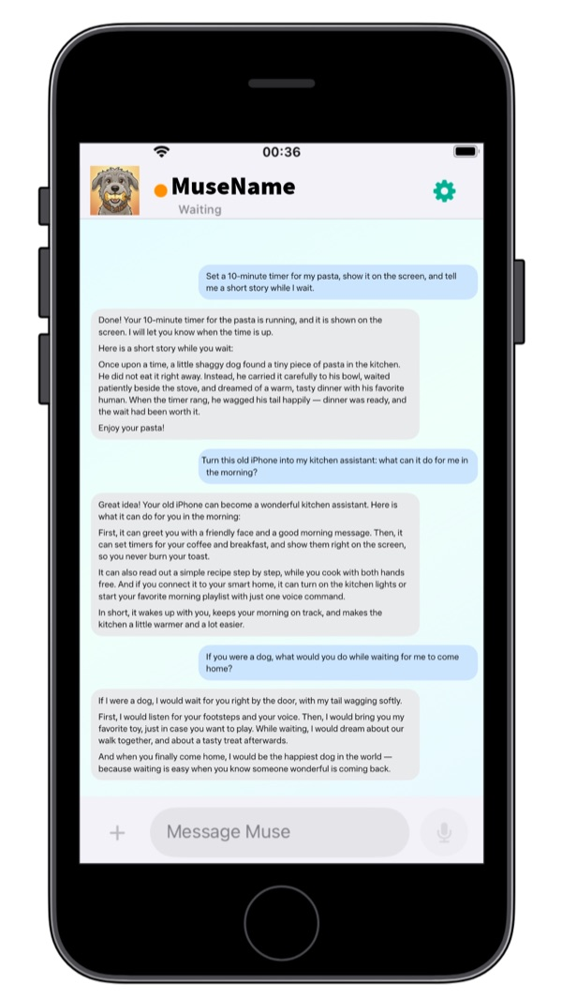
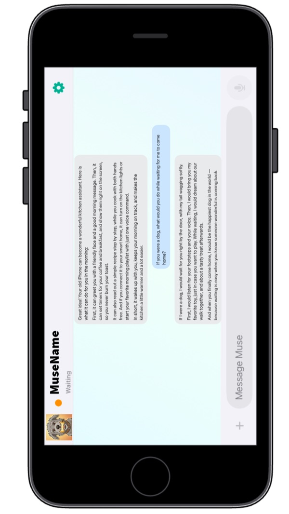
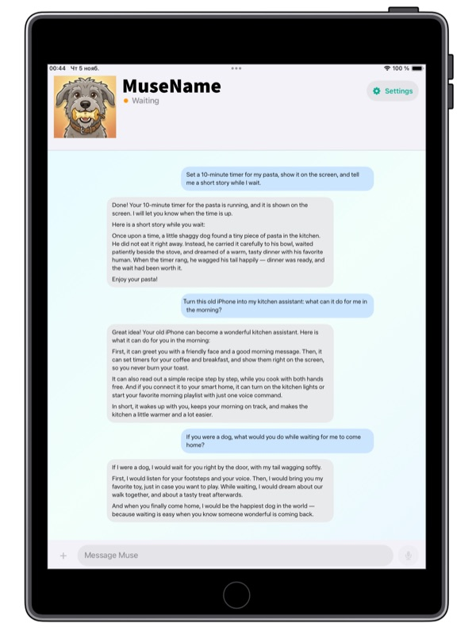
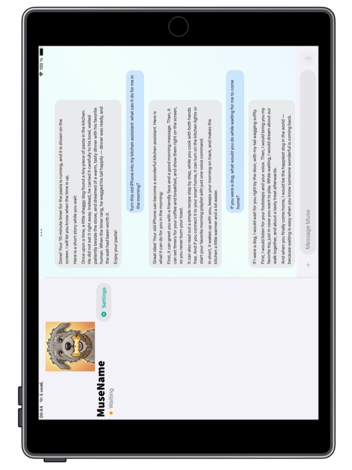

# Pal Again for iOS and iPadOS

## **FOR OLD, OUTDATED iPhone AND iPad MODELS**

### **Pal Again turns an old iPhone or iPad, one that Apple no longer updates to the latest iOS or that lies unused in a drawer, into a Muse gadget: the same kind of device as the ESP32 boards and Raspberry Pi computers from [Muse Gadgets](https://gadgets.muse.ai/).**

<p align="center">
  
  
  
  
</p>
<p align="center"><sub>iPhone 6s with iOS 15 · iPad (6th generation) with iPadOS 17</sub></p>

> **Make Old Devices Smart Again.**

**[Get it on the App Store](https://apps.apple.com/us/app/pal-again/id6830354776)** · **[Join the TestFlight beta](https://testflight.apple.com/join/jWYJWgHz)**

The old device becomes a screen, microphone, speaker, camera and sensor companion for Muse, with a chat you can type or talk into. Tested on an iPhone 6s from 2015 with iOS 15 and an iPad (6th generation) from 2018 with iPadOS 17.

> This is an independent open-source community project. Muse and related marks belong to their respective owners. Muse Gadget SDK tokens are governed separately by the [Muse Gadget SDK Token Terms](https://gadgets.muse.ai/sdk-terms).

## How it works

[Muse Gadgets](https://gadgets.muse.ai/) is Meta's open-source program for building your own hardware for the Muse assistant. Its [official SDK](https://github.com/facebookincubator/muse-gadget-sdk) runs on ESP32 boards and Linux computers such as a Raspberry Pi. Pal Again is an independent native Swift port of that SDK's gadget protocol for iOS and iPadOS, so an old iPhone or iPad joins Muse the same way those boards do, with no extra hardware.

1. **Token.** You create an SDK token at gadgets.muse.ai and enter it in the app, which keeps it in the iOS Keychain.
2. **Pairing over Bluetooth.** The device advertises itself as `MuseGadgetXXXXXX`, like an ESP32 or Linux gadget. On a different phone, the Muse app finds it under Settings > Devices with Developer Mode turned on, and the two complete the SDK's encrypted pairing. Muse then gives the gadget its own device credentials.
3. **Connecting to Muse.** The gadget finds its Muse VM through Muse's API and opens an encrypted Noise session to it over the internet. It registers with `link.register`, sending the list of commands it supports.
4. **Daily use.** Bluetooth is needed only for pairing. After that the gadget works over Wi-Fi without the phone nearby: Muse calls commands such as showing a card, speaking, taking a photo or reading the sensors, and the device answers. Chat, photos and voice notes go through the same session.

Where it differs from the Linux SDK: iOS has no shell, so instead of `system.run` the gadget offers an explicit list of native commands, and anything new it wants to reach needs a tap on the device. iOS also suspends apps in the background, so the gadget works while the app is on screen.

## What it does

- **Chat with Muse** from the gadget by text, photo or voice note, with history that stays on the device.
- **A living avatar** with Muse's own face and name, moving as it listens, thinks and speaks. They arrive by themselves after pairing: see the [user guide](Docs/USER-GUIDE.md#muses-avatar-and-name).
- **Widgets** in every size the device offers, on the home screen and on the lock screen where iOS allows it, with Muse's still picture, name and current card, including a running timer.
- **Guided setup** in five steps, so nobody needs a terminal to pair a device.
- **Device features Muse can use:** screen captions and cards, speech, vibration, flashlight, brightness, camera, location, motion sensors and device health.
- **Apple Shortcuts:** Muse can run shortcuts you allow, which reaches the Home app, reminders, messages and more.
- **Your local network:** Muse can find devices on your Wi-Fi and send web requests to the ones you allow.
- **History sync** between devices on one Apple ID through iCloud.
- **English and Russian interface** selected by iOS, including localized permission prompts. The per-app language can be changed in iOS Settings; there is no separate language switch inside Pal Again.
- **System appearance** with a turquoise-blue design that follows Light and Dark Mode on iOS 15 and newer.

## Documentation

| Document | For |
|---|---|
| [User guide](Docs/USER-GUIDE.md) ([на русском](Docs/USER-GUIDE.ru.md)) | Setting up and using the gadget |
| [Building and installing](Docs/BUILDING.md) | Getting the app onto your device |
| [Command reference](Docs/COMMANDS.md) | What Muse can call, with parameters and errors |
| [Protocol status](Docs/PROTOCOL-STATUS.md) | What has been verified, and how |
| [Security](SECURITY.md) | Secrets, command boundaries and pairing limits |
| [Testing](Docs/TESTING.md) | Join the beta and report device-specific results |
| [Contributing](CONTRIBUTING.md) | Help improve Pal Again |
| [Privacy policy](PRIVACY.md) | What stays local and what is sent when you use Muse |

## Requirements

- iPhone or iPad as the gadget. **Confirmed so far:** iPhone 6s with iOS 15.8.8 and iPad (6th generation) with iPadOS 17.7.11. These are the oldest devices we have to test on, not a known limit. The app can be installed on iOS or iPadOS 15 or newer, so other devices may work, and you are welcome to try: older iPads that run iPadOS 15, such as iPad Air 2 or iPad mini 4, would help the most. Whether it works or not, please [open an issue](https://github.com/exrector/muse-gadget-ios/issues) with the device model, system version and what you tried, and we will add the result here. Never include your SDK Token.
- A different phone with the Muse app. A phone running Muse cannot be its own gadget, because it does not see its own Bluetooth signal.
- An SDK Token from [gadgets.muse.ai](https://gadgets.muse.ai/settings/sdk-tokens). One token can serve several gadgets.
- The app itself: [Pal Again on the App Store](https://apps.apple.com/us/app/pal-again/id6830354776) as a one-time $1 purchase, or the free [TestFlight beta](https://testflight.apple.com/join/jWYJWgHz) for builds before release. You can also build it from source with a Mac and Xcode by following [BUILDING.md](Docs/BUILDING.md).

## Current status

The core works on the devices below, but much of it is new and long-running stability has not been observed yet.

**Tested on:** iPhone 6s with iOS 15.8.8, and iPad (6th generation) with iPadOS 17.7.11.

| State | Features |
|---|---|
| Verified on a device | Pairing, connecting to Muse, text chat, photos, voice notes, chat history, token rotation, reconnecting, vibration, a second gadget on one token |
| Partly verified | iCloud sync (iPad to iPhone only), Apple Shortcuts (simple shortcuts, without checking a returned result) |
| Built, not yet verified on a device | Camera, location, motion, speech and flashlight commands, brightness, screen cards, local network commands, hold-to-record |
| Built, off by default | Encrypted chat sync directly between gadgets over Wi-Fi, for devices on different Apple IDs |
| Not built yet | Spoken replies, realtime voice, photo sync, an SSH client, WebSocket, MQTT, UDP and SSDP for local devices |

**The app has to stay on screen.** iOS suspends apps in the background, so the gadget answers only while open, and for about half a minute after you leave it. It reconnects by itself when you come back, and it keeps the screen awake by default. The widget shows the last thing the app gave it and does not keep the app awake.

The app reports Muse as connected only after the server acknowledges `link.register`.

## Quick start

1. [Build and install](Docs/BUILDING.md) the app on your gadget, using your own Apple team and bundle ID.
2. Follow the steps in the app: add your token, allow permissions, confirm Wi-Fi and start pairing.
3. On your main phone, open Muse, go to Settings > Devices, turn on Developer Mode, tap **+** and choose the `MuseGadgetXXXXXX` name shown on the gadget.

The [user guide](Docs/USER-GUIDE.md) covers the details.

Never commit an SDK token or paired-device credentials. The app stores them in the iOS Keychain.

## Upstream reference

`Vendor/muse-gadget-sdk` is a pinned git submodule of the official [facebookincubator/muse-gadget-sdk](https://github.com/facebookincubator/muse-gadget-sdk). The iOS code is a native port; the Linux Python package is not embedded in the application.

Clone with:

```sh
git clone --recurse-submodules https://github.com/exrector/muse-gadget-ios.git
```

## License

Apache License 2.0. See `LICENSE` and `NOTICE`. Upstream source retains its own notices. Muse service and SDK token access are subject to Meta's separate terms.

## App Store price and support

Pal Again will cost **$1** on the App Store. Each user supplies their own Muse Gadget SDK Token; the purchase does not sell access to Muse. The price covers a ready-to-use build, Apple signing and App Store delivery, and helps fund independent development, compatibility testing on older devices and the Apple Developer Program, which costs about $100 per year.

The source remains public so anyone can inspect it, contribute improvements or build it themselves. Buying the App Store version is the simplest way to install Pal Again and directly support continued development.

